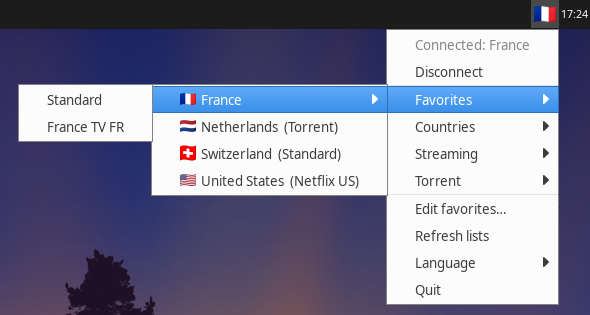
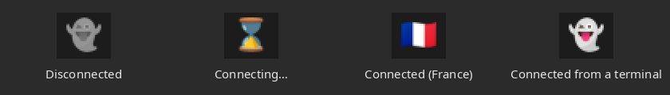
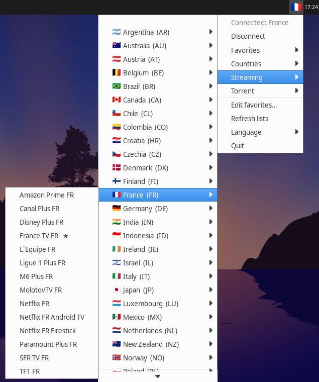
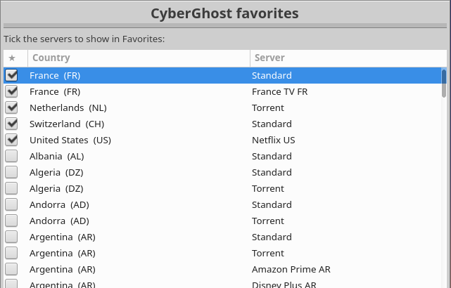

# cyberghost-indicator

System-tray indicator for the [CyberGhost VPN](https://www.cyberghostvpn.com) Linux CLI.
Pick a country, a streaming service, a torrent-optimized server or one of your favorites from the
menu, or disconnect.



The icon shows the state: grey ghost when disconnected, an animated hourglass while connecting or
disconnecting, the country's flag when connected, and a colored ghost when connected but the country is
unknown (connection made from the terminal).



Connections and disconnections show a notification. Failures (wrong server, timeout, …) show the CLI's
error message.


Streaming services are grouped by country. Favorite servers are marked ★:



It is a single static binary (Rust, no GTK): it talks the StatusNotifierItem D-Bus protocol,
and the desktop's tray draws the menu.

When you don't touch it (connected or not) it uses **no CPU at all**: no timer, no polling, no
command run in the background. The kernel wakes it up (netlink) only when a network interface
appears or disappears, and only then does it run `cyberghostvpn --status`. Measured: no CPU and
no wakeups while idle, ~4 MB of RAM.

## Favorites

Favorites are grouped by country. A country with a single favorite is one entry, "France  (Standard)".
A country with several favorites gets a sub-list: Standard, Torrent, then its streaming services.
Favorite servers are also marked ★ in the Countries, Streaming and Torrent lists.

**Edit favorites…** opens a window (zenity) listing every server, with your favorites ticked and at
the top. Tick or untick as many as you like, then press OK. Cancel changes nothing.



Favorites are edited in a window because the tray menu closes on every click (the panel does that,
the menu protocol has no "stay open").

Favorites are saved in `~/.config/cyberghost-indicator/favorites.json`.

## Requirements (runtime)

- Linux x86_64
- CyberGhost CLI (`cyberghostvpn`), already set up (`cyberghostvpn --setup`)
- A StatusNotifierItem tray: XFCE (Indicator Plugin / Status Tray), KDE Plasma, LXQt, Cinnamon, MATE,
  GNOME with the *AppIndicator and KStatusNotifierItem Support* extension
- `sudo` (or `pkexec`): `cyberghostvpn --connect/--stop` must run as root
- `zenity` for the favorites window: installed by default on Ubuntu and its flavours, and on
  Debian/Fedora GNOME. Otherwise install it: `sudo apt install zenity`, `sudo dnf install zenity`,
  `sudo pacman -S zenity`. The installer stops if it is missing
- Optional: `notify-send` (libnotify-bin) for notifications

## Install (from a release ZIP)

```sh
unzip cyberghost-indicator-<version>-x86_64-linux.zip
cd cyberghost-indicator-<version>-x86_64-linux
./install.sh             # per-user: ~/.local, autostart at login, launches it
```

The installer offers to add `/etc/sudoers.d/cyberghost-indicator`. This rule lets your user run
**only** `cyberghostvpn` as root without a password. Without it, `pkexec` asks for your password on
every connection.

Options: `--prefix DIR`, `--system` (all users, `sudo ./install.sh --system`), `--no-autostart`,
`--no-sudoers`, `--no-start`, `--yes`. Set `CYBERGHOST_BIN=/path/to/cyberghostvpn` if the CLI is
installed somewhere unusual: the sudoers rule and the autostart entry then use that path.

Uninstall: `~/.local/share/cyberghost-indicator/uninstall.sh` (add `--purge` to also drop the cache).

## Language

The UI is available in **English** and **French**. By default it follows the system language, using
gettext's rules:
- the locale is `LC_ALL`, else `LC_MESSAGES`, else `LANG`;
- `LANGUAGE` (e.g. `fr:en`) is tried first, except when the locale is `C`/`POSIX`;
- any unsupported language falls back to English.

To force a language, use the **Language** menu (*System default / English / Français*). The choice
applies immediately and is kept in the config file. Country and service names come from the
CyberGhost CLI, which only provides them in English.

## Settings

`~/.config/cyberghost-indicator/config.json` (all keys optional, written by the Language menu):

```json
{ "language": "system", "connect_timeout": 120, "status_interval": 0 }
```

| Key | Values | Meaning |
|---|---|---|
| `language` | `"system"`, `"en"`, `"fr"` | UI language |
| `connect_timeout` | 1–3600 s | give up on `cyberghostvpn --connect` after this long |
| `status_interval` | 0–3600 s | periodic `cyberghostvpn --status` check; `0` (default) = never. The applet is notified by the kernel when a network interface appears or disappears, and checks the status only then |

Invalid values fall back to the defaults.

## Development

Requirements: [rustup](https://rustup.rs) and `zip`. The toolchain (Rust 1.99.1 plus the musl target) is
pinned in `rust-toolchain.toml`, and rustup installs it on the first `cargo` command, so no other version
manager is needed. The end-to-end tests also need `dbus-daemon`. `make icons` needs `python3`, Pillow and
`fonts-noto-color-emoji`.

```sh
make help           # list targets
make run            # run from the source tree (uses ./assets/icons)
make test           # unit + end-to-end tests
make check          # rustfmt + clippy
make package        # dist/cyberghost-indicator-<version>-x86_64-linux.zip (static musl binary)
make test-all       # check + all tests + package and installer tests
make install        # build the package and install it for the current user
```

### Layout

```
src/main.rs                command line
src/app.rs                 main loop, actions (connect / disconnect / refresh), notifications
src/tray.rs                tray state, icon, menu (StatusNotifierItem via ksni)
src/cli.rs                 running cyberghostvpn and parsing its output
src/favorites.rs           favorites: model, grouping, persistence
src/dialog.rs              favorites window (zenity checklist)
src/i18n.rs                translations and language detection
src/store.rs               config, cache and state files
src/netwatch.rs            network-interface change notifications (rtnetlink)
src/icons.rs               bundled icons lookup, 16 px menu icons
assets/icons/              bundled PNG icons (generated, committed)
docs/screenshots/          README screenshots (XFCE panel, Greybird theme, fake CLI)
tools/render-icons.py      regenerates the icons from Noto Color Emoji (make icons)
scripts/build.sh           release build
scripts/package.sh         build + release ZIP (+ SHA256SUMS)
packaging/install.sh       installer shipped in the ZIP
packaging/uninstall.sh     uninstaller (also copied to <prefix>/share/cyberghost-indicator/)
tests/                     end-to-end, installer and package tests (see docs/TESTING.md)
```

### Adding a language

In `src/i18n.rs`:
1. Add a `Lang` variant.
2. Add a `Strings` constant.
3. List the language in `Lang::ALL` and in the two `match` blocks.

The compiler rejects a translation that is missing a field. The unit tests check that every
`{placeholder}` used in English is also used in each translation.

### Runtime files

- `$XDG_CACHE_HOME/cyberghost-indicator/`: `lists.json` (country/service lists, refreshed from the menu),
  `state.json` (last connected country), `lock` (single instance). A cache missing a list (e.g. written
  before torrent support) is completed automatically at startup
- `$XDG_CONFIG_HOME/cyberghost-indicator/config.json`: settings (see above)
- `$XDG_CONFIG_HOME/cyberghost-indicator/favorites.json`: favorites
- Icons are looked up next to the binary (`<prefix>/share/cyberghost-indicator/icons`), or in
  `$CYBERGHOST_INDICATOR_ICONS`
- CLI path: `/usr/bin/cyberghostvpn` by default, or `$CYBERGHOST_BIN`
- Favorites window: `zenity` from `PATH`, or `$CYBERGHOST_INDICATOR_ZENITY`

### Notes

- `cyberghostvpn --connect` exits with status 0 even when the connection fails. The indicator checks for
  "connection established" in the output, and confirms with `--status`.
- Every `ksni::Handle::update` re-sends the whole menu over D-Bus. The main loop keeps its own copy of the
  busy/connected state and only touches the tray when something changes.
- Idle cost: `cyberghostvpn --status` is a bundled Python program that costs ~200 ms of CPU per call,
  so it is never polled. Interface changes come from an rtnetlink socket (`src/netwatch.rs`).
  Without netlink (e.g. some sandboxes) the applet falls back to checking the interfaces every 3 s.
- ksni runs on tokio rather than async-io: the `blocking` thread pool used with async-io keeps an
  idle thread that wakes every 500 ms forever.
